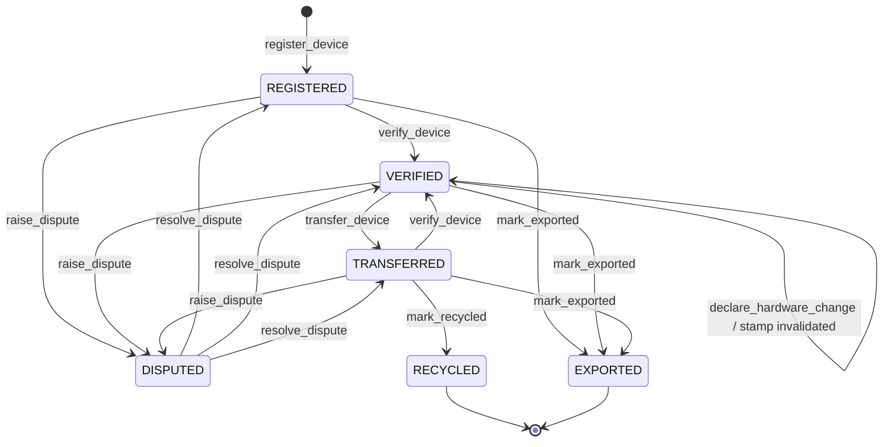
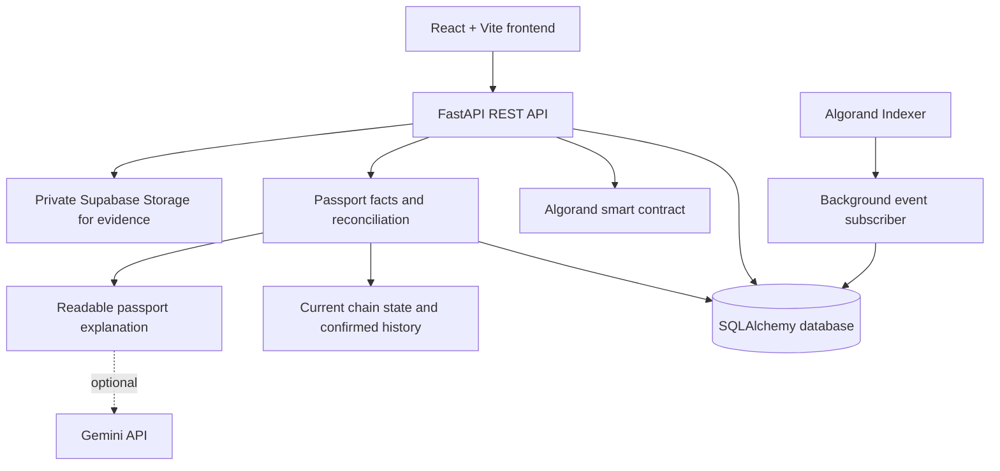

# TraceLoop

### Circular Electronics Digital Passport & Lifecycle Traceability

**IEEE ClimateChain — Track 3: Sustainable Supply Chains**

TraceLoop connects device owners, buyers, authorized service centres, and recycling facilities through a shared lifecycle passport for laptops. It brings ownership handoffs, inspection records, hardware changes, disputes, and end-of-life events into one traceable workflow.

**Reuse First, Verified Recycle Last.** TraceLoop is built around keeping devices useful for longer and recording their journey when reuse is no longer suitable.

## Why TraceLoop

A laptop's lifecycle is handled by different people and organizations: an owner, a refurbisher, a service centre, a buyer, and eventually a recycler. Their records can become fragmented as the device changes hands. TraceLoop gives these participants a consistent public Passport ID and a lifecycle record that can be checked against the blockchain and the application's event history.

The platform combines role-based workflows, an Algorand smart contract, a private application database, evidence records, and a readable digital passport. The passport helps the next participant understand the device's recorded history and whether the available sources agree.

## Features

### 1. Device lifecycle passport

- Register a laptop and create its public Passport ID.
- Keep the public Passport ID separate from the database's internal device identifier.
- View the device's current lifecycle state, verification information, hardware configuration history, and available lifecycle events.
- Review the passport's source coverage, reconciliation checks, and readable explanation.
- Open confirmed Algorand transaction references from the public activity views.
- Preserve historical legacy passports for read-only viewing.

### 2. Role-based participation

TraceLoop supports separate workspaces and permissions for:

| Role | Main responsibilities |
| --- | --- |
| First buyer / original owner | Register a device, manage its passport, request inspection, and initiate transfers. |
| Buyer | Accept or cancel an incoming ownership transfer and review the passport. |
| Reseller | Manage eligible devices, transfers, and marketplace listings. |
| Authorized verifier | Work on assigned inspection requests, inspect the physical device, and record a verification stamp. |
| Recycler | Manage incoming devices, acknowledge receipt, and record the recycling event. |
| Admin | Review accounts and credentials, manage role access, inspect evidence, review disputes, and triage lifecycle anomalies. |

### 3. Authorized verification and hardware re-qualification

- A device owner shares a passport with a specific authorized service-centre account.
- Verification requests are assigned to an individual verifier, and the verifier workspace shows assigned requests.
- The verifier records the inspection and stamp through the verification workflow.
- A declared hardware change creates a hardware-history record and invalidates the previous verification stamp.
- The device must be re-verified before it can move through a workflow that requires a valid stamp.
- Hardware logs preserve the declared component change and its recorded details.

### 4. Three-party ownership transfer

Ownership transfer follows a seller–buyer–verifier sequence:

1. **Seller initiates:** the current owner starts a transfer to the intended buyer.
2. **Buyer accepts:** the incoming buyer explicitly accepts the pending handoff.
3. **Assigned verifier completes:** the assigned verifier checks the physical handoff and completes the transfer workflow.

The application checks the actor's role, transfer assignment, device state, buyer acceptance, and verification requirements. The smart contract enforces the permitted on-chain lifecycle transitions, including the requirement for a valid verification stamp before transfer.

The transfer workspace also supports eligible marketplace listings, incoming transfer requests, pending verifier completion, transfer history, and in-workflow notifications.

### 5. Reuse-to-recycling lifecycle

TraceLoop separates recycler receipt from the final recycling event:

1. An eligible device is transferred to the recycler through the ownership workflow.
2. The recycler records physical receipt.
3. The recycler completes the recycling workflow, recording the terminal `RECYCLED` lifecycle event.

The contract requires a transfer to the recycler before the device can be marked recycled and prevents additional lifecycle actions on terminal `RECYCLED` or `EXPORTED` states. Admins can also record an export event through the admin workflow.

### 6. Disputes and lifecycle control

- Raise disputes for issues such as misrepresented specifications, suspected theft, a questionable verification stamp, or an ownership dispute.
- Review the device and dispute history.
- Freeze a device while a dispute is under review.
- Resolve or dismiss a dispute through the authorized workflow.
- Require verification again after dispute resolution where the lifecycle rules call for it.
- Enforce valid state transitions through the application and the Algorand smart contract.

### 7. Passport reconciliation

The passport intelligence service compares three sources:

- **Current on-chain state** from the Algorand application.
- **Confirmed on-chain history** retrieved through the Algorand Indexer.
- **TraceLoop's database record and event mirror**.

It returns explicit reconciliation outcomes, including `MATCH`, `CONFLICT`, `PENDING_SYNC`, `CHAIN_ONLY`, `OFFCHAIN_ONLY`, `PARTIAL`, and `SOURCE_UNAVAILABLE`. Individual checks can compare lifecycle state, ownership commitment, configuration commitment, and verification-stamp validity. Source availability and history coverage are included in the result shown by the passport view.

### 8. AI-assisted explanations and anomaly triage

**Public passport explanation**

The passport explanation service turns already-assembled, structured passport facts into a readable status explanation. It uses Gemini when configured and falls back to a deterministic explanation when the model is unavailable or its output does not pass validation. Reconciliation status and lifecycle facts are computed independently of the wording layer.

**Admin Lifecycle Anomaly Triage**

The admin console includes a read-only anomaly panel driven by deterministic rules over existing TraceLoop records. It surfaces review signals such as:

- Transfer policy flags.
- Repeated hardware changes within the analysis window.
- Clusters of verification stamps.
- Stale or uncertain transfer, recycling, or registration submissions.
- Verification-stamp versus hardware-history inconsistencies.
- Dispute and device-state mismatches.

When `GEMINI_API_KEY` is configured, an optional AI brief can summarize the generated findings and suggest source-record checks. Findings are returned with source references so an administrator can inspect the underlying records.

### 9. Evidence, identity, and account approvals

- Phone-based registration and OTP sign-in.
- Access and refresh tokens for authenticated sessions.
- Role-based account activation and administrator approval.
- Credential and evidence uploads, review status, and re-submission workflows.
- A protected administrator evidence viewer backed by private Supabase Storage.
- Assigned-verifier access to owner-shared inspection requests.
- Role activation checks for protected verifier and recycler operations.

### 10. Notifications and Eco Points

- An authenticated notification centre for supported lifecycle updates.
- Individual and bulk mark-as-read actions.
- Periodic refresh while the application is active.
- An Eco Points endpoint and account view for a user's recorded points.

### 11. Climate & Circularity homepage

The homepage includes a Climate & Circularity section that reads configured public virtual-device passports from the intended Algorand TestNet-backed API. It displays confirmed transaction counts, recorded ownership transitions, recorded recycling transactions, links to related passports and transactions, and separate fields for CO₂e avoided and physical e-waste mass.

The current interface shows **CO₂e avoided: Not calculated** and **Physical e-waste mass: Not measured** until corresponding measurement methods and records are available.

## Lifecycle model

The smart contract enforces the core state transitions:



A valid verification stamp is required for transfer. Declaring a hardware change invalidates that stamp until an authorized verifier completes a new verification. `RECYCLED` and `EXPORTED` are terminal states.

## Architecture



### Technology stack

| Layer | Technology |
| --- | --- |
| Frontend | React 18, Vite 6, React Router, Lucide React |
| Backend API | Python, FastAPI, Pydantic, Uvicorn |
| Database | SQLAlchemy; SQLite for local development or PostgreSQL for deployment |
| Blockchain | Algorand, ARC-4 application calls, ARC-28 lifecycle events |
| Chain integration | `py-algorand-sdk`, Algod, Algorand Indexer, background event subscriber |
| Evidence storage | Supabase Storage private bucket |
| AI-assisted wording | Gemini API, optional and server-side |
| Frontend deployment | Vercel-compatible Vite build |

## Repository structure

```text
trace-loop-clean/
├── README.md
├── .env.example
├── frontend/
│   ├── src/
│   │   ├── App.jsx              # Routes, navigation, role-aware shell
│   │   ├── pages.jsx            # Landing page and role workspaces
│   │   ├── api.js               # API client and session handling
│   │   ├── context.jsx          # Authentication and toast contexts
│   │   ├── ui.jsx               # Shared interface components
│   │   └── styles.css
│   ├── .env.example
│   └── package.json
├── pillar-2/
│   ├── app.py                   # FastAPI application and router registration
│   ├── auth.py                  # Authentication and role checks
│   ├── database.py              # SQLAlchemy models and database setup
│   ├── routes/                  # API route modules
│   ├── services/                # Ledger, identity, history, passport and AI services
│   ├── migrations/              # Existing-database schema migrations
│   ├── tests/                   # Backend test suite
│   └── requirements.txt
└── smart_contract/
    ├── contract.py              # Algorand smart contract source
    ├── deploy.py                # TestNet deployment entry point
    ├── traceloop_client.py      # Generated contract client
    ├── artifacts/               # Contract ABI/artifacts
    └── tests/                   # Contract tests
```

The active frontend is `frontend/`. `frontend/legacy-static-backup/` retains the earlier static frontend for reference and is not the Vite application entry point.

## Getting started

### Prerequisites

- Python 3.10 or newer.
- Node.js 18 or newer and npm.
- An Algorand TestNet application deployment for blockchain-backed workflows.
- PostgreSQL for a persistent shared deployment, or SQLite for a local development run.
- Supabase Storage credentials for protected evidence uploads.
- Gemini API access for optional AI-generated explanations and admin summaries.

### 1. Configure and run the backend

From the repository root:

```bash
cd pillar-2
python -m venv .venv
```

Activate the environment:

```bash
# macOS / Linux
source .venv/bin/activate

# Windows PowerShell
.venv\Scripts\Activate.ps1
```

Install dependencies:

```bash
python -m pip install --upgrade pip
pip install -r requirements.txt
```

Create `pillar-2/.env` and set the backend configuration. A local SQLite database is used when `DATABASE_URL` is omitted.

```dotenv
DATABASE_URL=sqlite:///./traceloop.db
JWT_SECRET=replace_with_a_long_random_secret
ACCESS_TOKEN_EXPIRE_MINUTES=60
REFRESH_TOKEN_EXPIRE_DAYS=30

APP_ID=771258340
ALGOD_URL=https://testnet-api.algonode.cloud
ALGOD_TOKEN=
INDEXER_URL=https://testnet-idx.algonode.cloud
INDEXER_TOKEN=
SUBSCRIBER_START_ROUND=50000000
SUBSCRIBER_WATERMARK_PATH=subscriber_watermark.txt

# Backend-managed signing accounts for contract operations
OPERATOR_MNEMONIC=
VERIFIER_MNEMONIC=
RECYCLER_MNEMONIC=
ADMIN_MNEMONIC=

# Frontend origins permitted by FastAPI CORS
ALLOWED_ORIGINS=http://localhost:5173

# Optional AI integration
GEMINI_API_KEY=
GEMINI_MODEL=

# Optional SMS OTP delivery
FAST2SMS_API_KEY=
OTP_PREVIEW_ENABLED=false

# Private evidence storage
SUPABASE_URL=
SUPABASE_SECRET_KEY=
SUPABASE_EVIDENCE_BUCKET=traceloop-evidence-private
```

Start FastAPI from the `pillar-2/` directory:

```bash
uvicorn app:app --reload --host 0.0.0.0 --port 8000
```

On startup, the backend verifies the database connection, creates missing tables from the SQLAlchemy models, and starts the Algorand event-subscriber thread. The API root is available at `http://localhost:8000/`, interactive Swagger documentation at `http://localhost:8000/docs`, and ReDoc at `http://localhost:8000/redoc`.

#### Backend configuration reference

| Variable | Purpose |
| --- | --- |
| `DATABASE_URL` | SQLAlchemy database URL. Defaults to `sqlite:///./traceloop.db`; use a PostgreSQL URL for a shared deployment. |
| `JWT_SECRET` | Secret used to sign authentication tokens and OTP hashes. |
| `ACCESS_TOKEN_EXPIRE_MINUTES` / `REFRESH_TOKEN_EXPIRE_DAYS` | Authentication token lifetimes. |
| `APP_ID` | Algorand application ID. The code's default is `771258340`. |
| `ALGOD_URL` / `ALGOD_TOKEN` | Algod node endpoint and optional access token. |
| `INDEXER_URL` / `INDEXER_TOKEN` | Indexer endpoint and optional access token. |
| `OPERATOR_MNEMONIC` | Backend signing account for operator-mediated contract actions. |
| `VERIFIER_MNEMONIC` | Backend signing account for verifier-role contract actions. |
| `RECYCLER_MNEMONIC` | Backend signing account for recycler-role contract actions. |
| `ADMIN_MNEMONIC` | Backend signing account for admin-role contract actions. |
| `ABI_PATH` | Optional path to the contract JSON artifact; defaults to `smart_contract/artifacts/contract.json`. |
| `SUBSCRIBER_START_ROUND` | Initial Algorand Indexer round scanned by the event subscriber; defaults to `50000000`. |
| `SUBSCRIBER_WATERMARK_PATH` | File used by the subscriber to persist the last fully processed round. |
| `ALLOWED_ORIGINS` | Comma-separated frontend origins allowed by CORS. |
| `GEMINI_API_KEY` / `GEMINI_MODEL` | Optional Gemini configuration for passport explanations and admin anomaly summaries. |
| `FAST2SMS_API_KEY` | Optional SMS provider key for OTP delivery. |
| `OTP_PREVIEW_ENABLED` | Enables the backend's explicit demo OTP preview fallback when SMS delivery is unavailable. Defaults to `false`. |
| `SUPABASE_URL` | Supabase project URL used for private evidence storage. |
| `SUPABASE_SECRET_KEY` or `SUPABASE_SERVICE_ROLE_KEY` | Backend credential for the Supabase Storage operations. |
| `SUPABASE_EVIDENCE_BUCKET` | Private evidence bucket name; defaults to `traceloop-evidence-private`. |
| `PORT` / `ENV` | Runtime port and environment mode used by the module entry point. |

### 2. Apply migrations to an existing database

For an existing PostgreSQL database, apply the migrations in chronological order and verify that the corresponding schema changes are present:

```text
pillar-2/migrations/20261017_phase2_public_device_id.sql
pillar-2/migrations/20261019_phase4_notifications.sql
pillar-2/migrations/20261021_phase4_transfer_verifier_assignment.sql
```

A new local database can be initialized from the SQLAlchemy models at application startup.

### 3. Configure and run the frontend

Open a second terminal from the repository root:

```bash
cd frontend
npm install
cp .env.example .env
```

Set `VITE_API_BASE` in `frontend/.env` to the backend origin. For local development:

```dotenv
VITE_API_BASE=http://localhost:8000
VITE_DEMO_NETWORK=TESTNET
VITE_DEMO_PASSPORT_ID=
VITE_DEMO_PASSPORT_IDS=
```

Start Vite:

```bash
npm run dev
```

Open the local URL printed by Vite, usually `http://localhost:5173`.

#### Frontend configuration reference

| Variable | Purpose |
| --- | --- |
| `VITE_API_BASE` | FastAPI base URL. Defaults in the frontend client to the deployed TraceLoop API if not overridden. |
| `VITE_DEMO_PASSPORT_ID` | Optional public Passport ID used by the landing-page sample-passport link and as the single-passport fallback for the homepage demo. |
| `VITE_DEMO_PASSPORT_IDS` | Optional comma-separated list of public virtual-device Passport IDs used by the Climate & Circularity activity section. Up to ten are loaded. |
| `VITE_DEMO_NETWORK` | Set to `TESTNET` when the configured API is backed by the intended Algorand TestNet deployment. |

### 4. Build the frontend

```bash
cd frontend
npm run build
npm run preview
```

The production output is written to `frontend/dist/`. For Vercel, use `frontend/` as the project root, `npm run build` as the build command, and `dist` as the output directory. Configure the deployed frontend origin in the backend's `ALLOWED_ORIGINS` setting.

## Running the tests

Install the backend requirements and pytest, then run the backend tests from the `pillar-2/` directory:

```bash
cd pillar-2
pip install pytest
python -m pytest tests -q
```

The backend suite covers areas such as public passport privacy, lifecycle-anomaly rules, notifications, device identity, event decoding, passport facts and formatting, and credential-status handling.

The smart-contract source and test suite are located under `smart_contract/`. The contract deployment entry point is `smart_contract/deploy.py`; the generated contract client and compiled artifacts are included in the repository.

## API overview

The backend exposes interactive request and response schemas through `/docs`. Primary route groups include:

| Route group | Purpose |
| --- | --- |
| `/api/v1` | Registration, OTP authentication, token refresh, user profile, and KYC flows. |
| `/devices` | Device registration, owner devices, public passport retrieval, and device details. |
| `/verification` | Inspection requests, assigned-verifier queue, verification stamps, and verification history. |
| `/device-profiles` | Hardware-change declarations and hardware logs. |
| `/transfers` | Marketplace listings, transfer initiation, buyer acceptance, cancellation, verifier completion, and transfer history. |
| `/recycling` | Recycler workflow, physical receipt, and recycling completion. |
| `/disputes` | Dispute reporting, freeze, review, resolution, and history. |
| `/ledger` | On-chain device state and mirrored ledger events. |
| `/passport-intelligence` | Public passport facts, reconciliation checks, source coverage, and readable explanation. |
| `/admin` | Account and evidence approvals, role access, device administration, exports, and lifecycle anomaly triage. |
| `/analytics` | Lifecycle analytics, overview, and recent events. |
| `/api/v1/notifications` | List notifications and mark notifications as read. |
| `/api/v1/rewards` | Current user's recorded Eco Points. |
| `/manufacturer` | Manufacturer/serial lookup workflow. |

## Project direction

TraceLoop brings reuse, repair and refurbishment, verified ownership transitions, and recorded end-of-life handoff into a single lifecycle passport. The blockchain layer enforces the permitted device-state transitions and supplies an auditable event history; the backend coordinates role-based workflows, evidence records, notifications, reconciliation and administrative review; and the frontend makes those records accessible to each participant.
